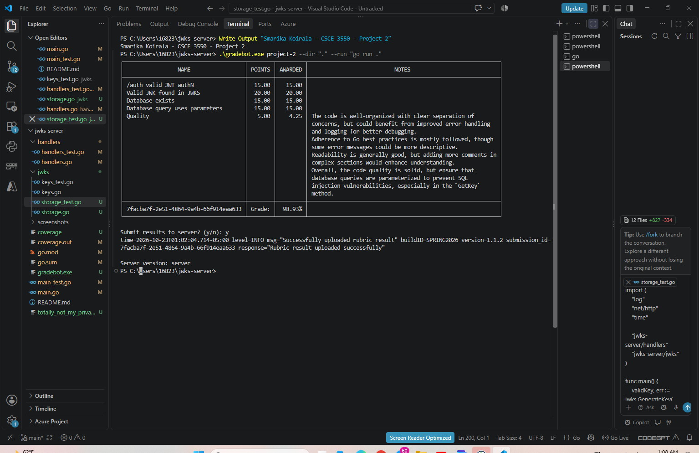
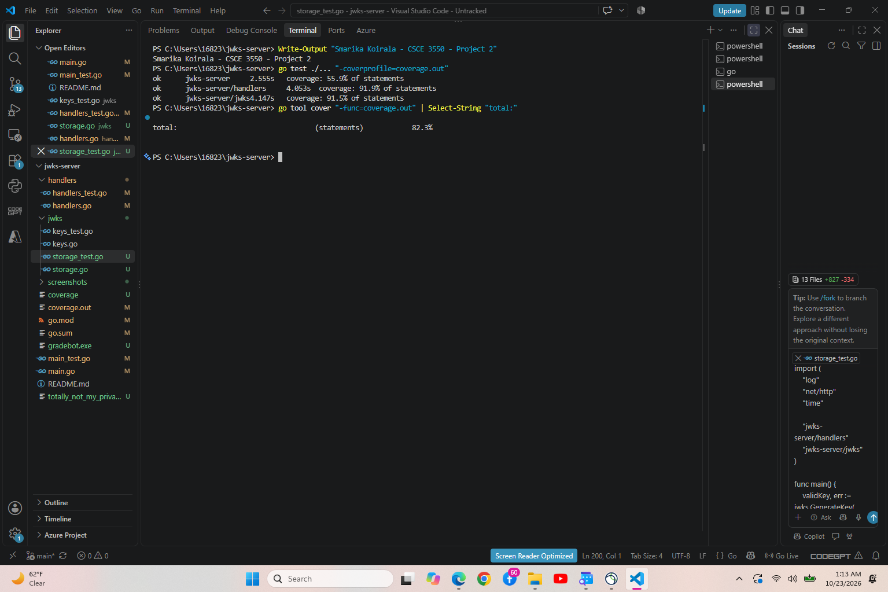

# SQLite-Backed JWKS Server — CSCE 3550 Project 2

Author: Smarika Koirala

## Description

This Go server stores RSA private keys in SQLite, issues signed JWTs,
and publishes unexpired public keys in JWKS format.

Database file: totally_not_my_privateKeys.db

Private keys are stored as PKCS#1 PEM-encoded BLOBs. SQL queries use
parameters to keep values separate from SQL commands. Database-generated
IDs are used as the JWT and JWK kid values.

Existing keys persist across restarts. At startup, the server ensures
that an expired key and a key valid for at least another hour exist.

## Database Schema

```sql
CREATE TABLE IF NOT EXISTS keys(
    kid INTEGER PRIMARY KEY AUTOINCREMENT,
    key BLOB NOT NULL,
    exp INTEGER NOT NULL
);
```

## Run

Requires Go 1.23.2 or newer. From the project directory:

```powershell
go mod download
go run .
```

The server listens on port 8080 and creates the database automatically.

## Endpoints

- GET /.well-known/jwks.json — returns all unexpired public keys.
- POST /auth — returns a JWT signed with an unexpired database key.
- POST /auth?expired=true — returns an expired JWT signed with an
  expired database key.

Any presence of the expired query parameter selects an expired key.
Authentication is mocked; credentials are not validated.

## Tests and Code Checks

```powershell
go test ./... "-coverprofile=coverage.out"
go tool cover "-func=coverage.out"
go vet ./...
```

Overall test coverage: 82.3%.

Tests check JWT signatures, expiration, JWKS filtering, database
persistence, corrupt key data, and database errors.

## Gradebot

Obtain the instructor-provided gradebot.exe separately.
Stop any server already running on port 8080, then run from the
project directory:

```powershell
.\gradebot.exe project-2 --dir="." --run="go run ."
```

Reported Gradebot result: 98.93%. Final grading also includes the
remaining assignment deliverables.

## Screenshots





## Generated Files

The private-key database and Gradebot executable are not included
in the repository. The server generates its database when started.